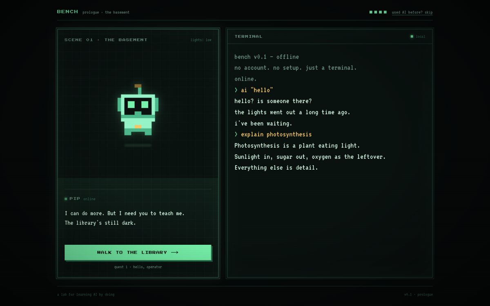

<div align="center">

# BENCH

### A pixel lab where complete beginners learn to actually use AI.

Wake a dormant agent in a basement. Teach it what you know. One quest at a time.

[](https://nextjs.org)
[](https://react.dev)
[](https://www.typescriptlang.org/)
[](https://tailwindcss.com)
[](./LICENSE)

[Run it](#run-it) · [How it works](#how-it-works) · [Roadmap](#roadmap)

</div>


## What is this?

Bench is a game, not a course catalog.

You arrive in a dark basement lab and find **Pip** — a small machine that has been waiting a long time. It can talk, but it can't tell when it's wrong. Over six ranks you teach it to verify, use tools, run flows, and eventually work without you.

It's built for people who don't write code: BBA, MBA, BCom, design, and anyone who wants to use AI well without a CS degree. The terminal is a guided command box, not a shell. The first command anyone types is `ai "..."` — never `ls`.

**The design rule:** every rank unlocks a new *verb*, not just more lessons.

## What's in v0.1

- **Landing page** with a living scene and a progress strip
- **The prologue** — four beats, first win in under a minute:
  1. Wake Pip up
  2. Run your first command (pre-written — just press Enter)
  3. Ask something real
  4. Catch Pip in a confident lie, and learn why verification is your job
- **Quest 01 · Hello, Operator** — ask the same question twice, add one constraint, pick the better answer
- **+10 XP**, a **Clarity Lens** notebook item, and `Operator · 1/5` rank progress
- Progress saved locally, no account required

| The prologue | Quest 01 |
| --- | --- |
|  |  |

## Run it

Requires Node.js 20.9 or newer.

```bash
npm install
npm run dev
```

Open [http://localhost:3000](http://localhost:3000).

```bash
npm run lint       # eslint
npm run typecheck  # tsc --noEmit
npm run build      # production build
```

## How it works

**Scripted runtime, real interface.** v0.1 runs a small command layer in the browser — no server, no API keys, no setup. The prologue and quest 01 are phase machines over a `TLine[]` stream.

**Progress is local.** XP and notebook items live in `localStorage`, read through `useSyncExternalStore` and updated by an append-style event (`bench:progress`). There is no auth or database yet.

**The seam is deliberate.** `Terminal` only renders lines; the phase machine owns state. A real model proxy and a sandboxed runtime can slot in behind the same interface without rewriting the content. That's the next build.

**Nothing can be broken.** Hints, retries, and reset are part of the design. The prologue has no wrong answer.

## Project structure

```text
src/
  app/
    page.tsx           landing page
    play/page.tsx      the prologue
    quest/1/page.tsx   quest 01
    globals.css        CRT, pixel panels, buttons
  components/
    Prologue.tsx       prologue state machine + copy
    QuestOne.tsx       quest 01
    Dialogue.tsx       typewriter + Pip's voice
    Terminal.tsx       line renderer
    PipSprite.tsx      the pixel robot
    ProgressStrip.tsx  local XP display
  lib/
    progress.ts        XP, notebook, storage events
    useProgress.ts     useSyncExternalStore hook
docs/                  README screenshots
```

## Design rules

1. The first command is `ai "..."`, never `ls`.
2. Nothing can be broken. Nudges, never red X's.
3. The prologue is a chapter, not a gate.
4. Each rank unlocks a new verb, not just more lessons.

## Roadmap

| Rank | Zone | New verb | Promotion test |
| --- | --- | --- | --- |
| **Operator** | Library | `ai` | The Confident Liar |
| **Analyst** | Archive | `check` | The Vague Machine |
| **Tinkerer** | Workshop | `flow` | The Runaway |
| **Integrator** | Server Room | `tool` | The Overreach |
| **Engineer** | Observatory | `eval` | The Gauntlet |
| **Architect** | Rooftop | `deploy` | The Capstone |

Next up:

- Quests 02–05 and the Confident Liar boss
- A real model proxy behind the `ai` command, rate-limited per session
- The rank/unlock engine as data, with ranks 3–6 visible as locked silhouettes
- Auth and synced progress once retention is proven

## Status

Early prototype, v0.1. The AI is scripted, XP is local, and there is no backend. That's intentional — the goal is to prove the loop before adding infrastructure.

Independent student project. Not affiliated with any company or institution.

## License

MIT — see [LICENSE](./LICENSE).
