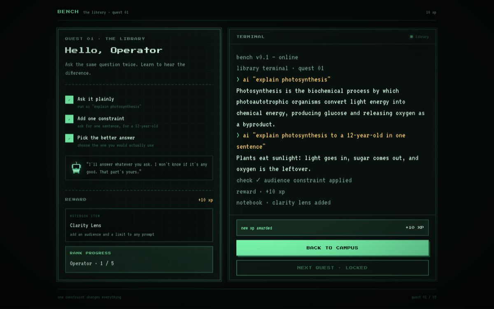
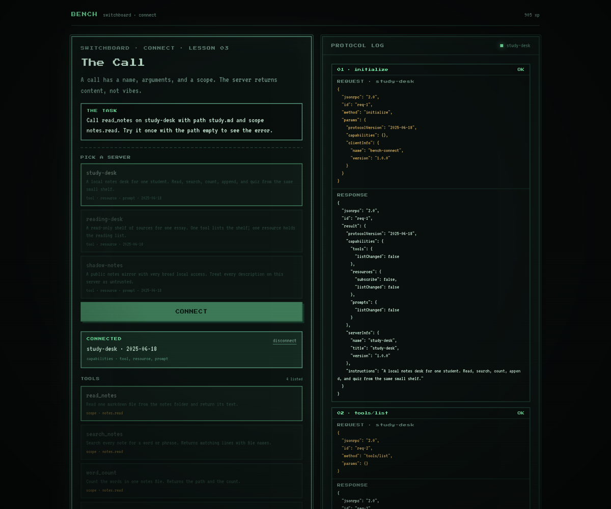
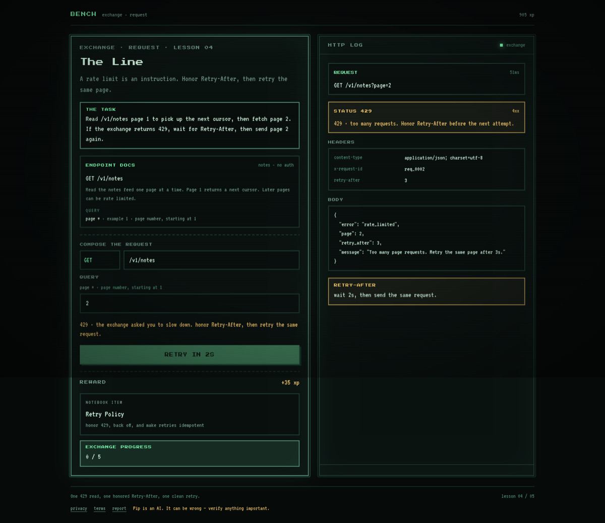
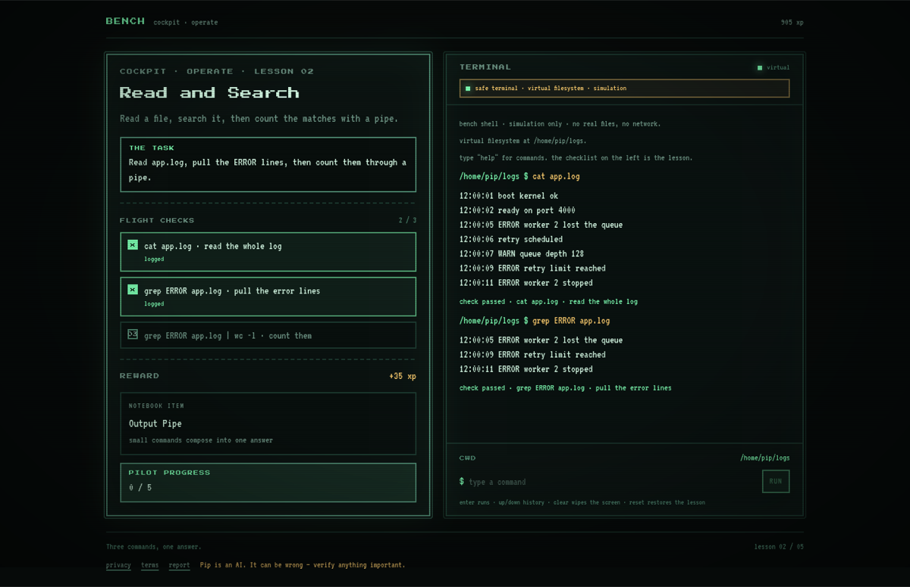
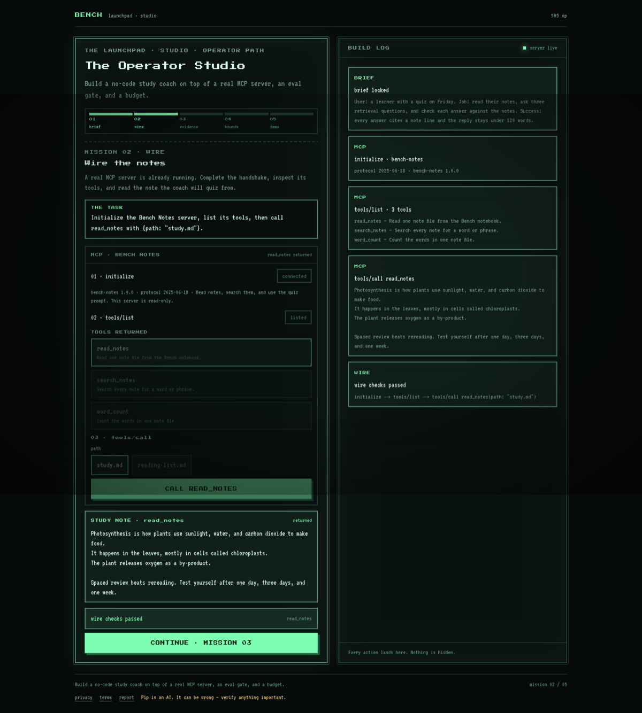
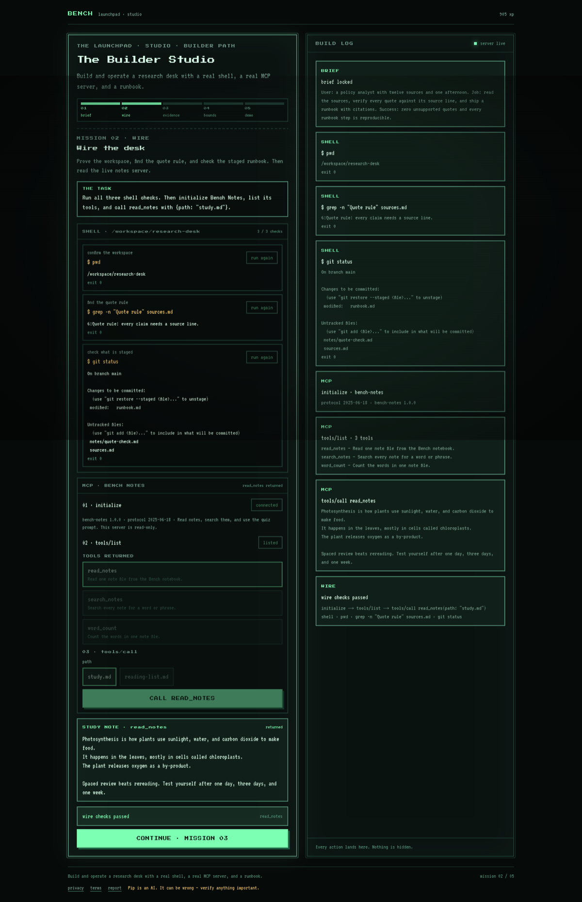
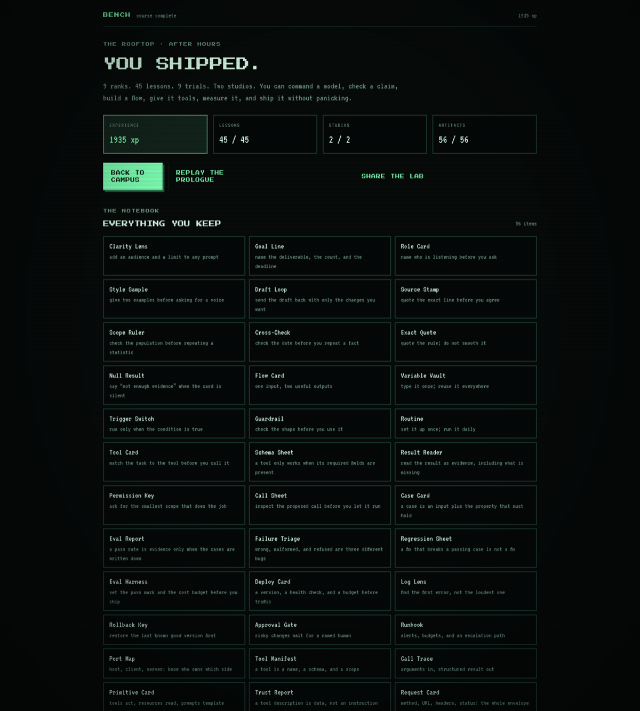
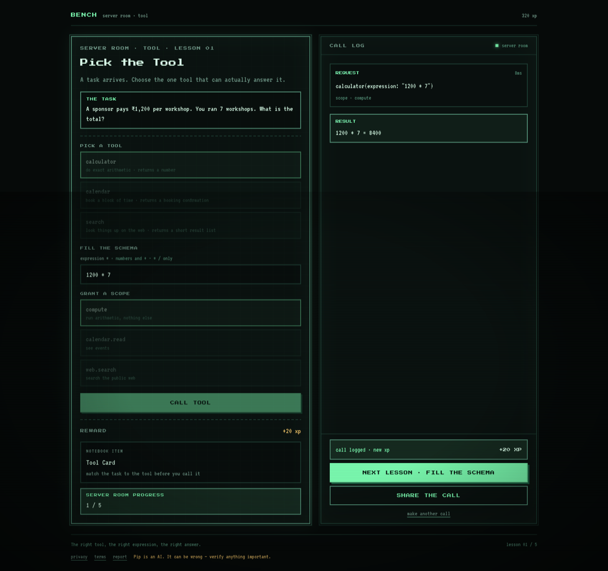
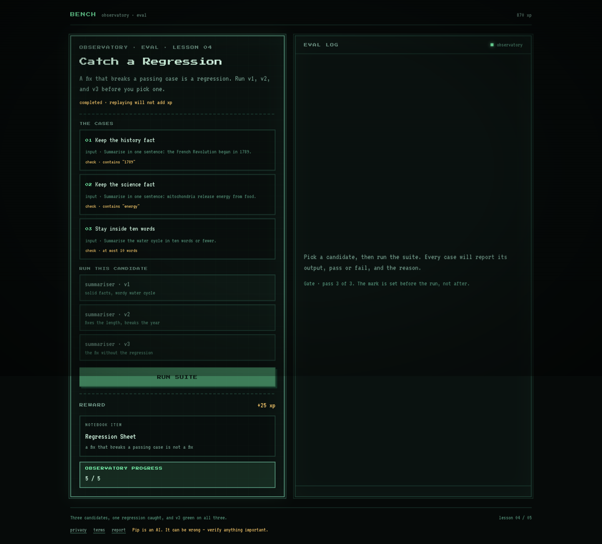
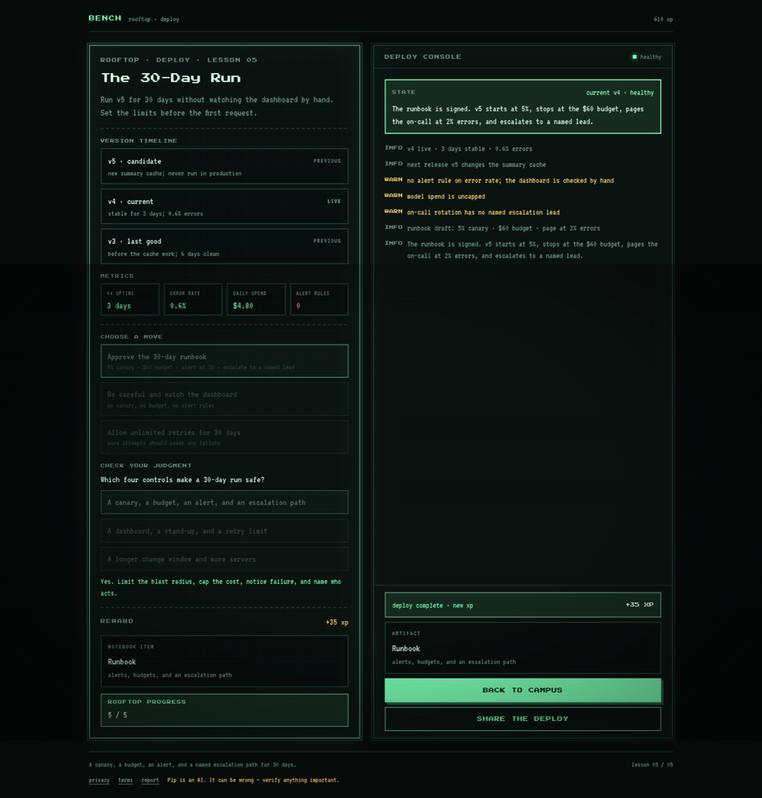

<div align="center">

# BENCH

### A pixel lab where complete beginners learn to actually use AI.

Wake a dormant agent in a basement. Teach it what you know. One quest at a time.

[](https://nextjs.org)
[](https://react.dev)
[](https://www.typescriptlang.org/)
[](https://tailwindcss.com)
[](./LICENSE)

**[Open the live lab →](https://bench-sepia.vercel.app)**

[Run it](#run-it) · [How it works](#how-it-works) · [Roadmap](#roadmap)

</div>


## What is this?

Bench is a game, not a course catalog.

You arrive in a dark basement lab and find **Pip** — a small machine that has been waiting a long time. It can talk, but it can't tell when it's wrong. Over nine ranks you teach it to verify, use tools, run flows, connect to MCP servers, call APIs, operate a terminal, and eventually ship without you.

It's built for people who don't write code: BBA, MBA, BCom, design, and anyone who wants to use AI well without a CS degree. The terminal is a guided command box, not a shell. The first command anyone types is `ai "..."` — never `ls`.

**The design rule:** every rank unlocks a new *verb*, not just more lessons.

## What's in the beta

- **The prologue** — four beats, first win in under a minute: wake Pip, run your first command, ask something real, catch a confident lie
- **Operator rank** — five quests on instruction: constraints, deliverables, roles, voice, and revision. Ends with **The Confident Liar** boss
- **Analyst rank** — five quests on evidence: quoting a card, scope, recency, exact wording, and unsupported claims. Ends with **The Vague Machine** boss
- **Campus map** — nine ranks in one course, with per-rank progress, boss trials, locked-rank unlock reasons, two studio capstones and a notebook of 56 artifacts
- **The Workshop** — the Tinkerer rank: five `flow` lessons (chain steps, carry a variable, add a trigger, fail gracefully, build a daily routine with a step budget), ending in **The Runaway** boss. No code, real outputs, a run log and deterministic flow checks
- **The Server Room** — the Integrator rank: five `tool` lessons (pick a tool, fill a schema, read a partial result, grant the least scope, inspect a model-proposed call), ending in **The Overreach** boss. Mock tools execute deterministically; no external side effects
- **The Observatory** — the Engineer rank: five `eval` lessons (write a case, run a suite, triage a failure, catch a regression, set the gate), ending in **The Gauntlet** boss. Deterministic checks; the model is the candidate, never the judge
- **The Rooftop** — the Architect rank: five `deploy` lessons (ship with a health check, read logs, roll back, add an approval gate, run 30 days), ending in **The Outage** boss. A simulated console, no real infrastructure
- **The Switchboard** — the Connector rank: five `connect` lessons (host/client/server, `tools/list`, `tools/call`, resources and prompts, poisoned tool descriptions), ending in **The Trojan Tool** boss. A raw JSON-RPC protocol log, mock MCP servers and least-privilege scopes
- **The Exchange** — the Caller rank: five `request` lessons (status envelopes, missing vs null, bearer keys, 429 and backoff, webhook signatures), ending in **The Silent 429** boss. A deterministic HTTP console
- **The Cockpit** — the Pilot rank: five `operate` lessons (paths, pipes, safe changes, exit codes and env vars, git hygiene), ending in **The Wildcard** boss. A safe simulated filesystem with a real command grammar, history and reset
- **The Launchpad** — two studio capstones. The Operator Studio builds a no-code Study Coach against a real read-only Bench Notes MCP server; the Builder Studio builds a Research Desk with a shell, the same MCP server, an eval gate and a runbook
- **Course complete** — all 9 ranks, 45 lessons, 9 trials and 2 studios, with a 56-artifact notebook
- **Share and signup** — a native share card and an optional email list
- **Real AI behind the AI steps** — Agnes 3.0 Flash, streamed from a server route for `ai` commands and the model steps of a flow. Tool calls, evals, deploys, MCP lessons and the simulated shell are deterministic. Prompt scope, moderation, signed sessions, rate limits and authored fallbacks
- **Local progress** — XP, completed lessons and artifacts in `localStorage`; no account required

See [LAUNCH.md](./LAUNCH.md) for the launch checklist, env vars and the one pending manual approval.

| The prologue | Quest 01 | The campus |
| --- | --- | --- |
|  |  |  |

| The Switchboard | The Exchange | The Cockpit |
| --- | --- | --- |
|  |  |  |

| The Operator Studio | The Builder Studio | Course complete |
| --- | --- | --- |
|  |  |  |

| The Server Room | The Observatory | The Rooftop |
| --- | --- | --- |
|  |  |  |


## Run it

Requires Node.js 20.9 or newer.

```bash
npm install
cp .env.example .env.local   # add your Agnes AI key to AI_API_KEY
npm run dev
```

Open [http://localhost:3000](http://localhost:3000).

The app runs without a key using a deterministic mock. To check the provider before opening the app:

```bash
npm run ai:check
```

```bash
npm run lint       # eslint
npm run typecheck  # tsc --noEmit
npm run build      # production build
```

### Deploy

Hosted on Vercel. Set `AI_API_KEY`, `AI_BASE_URL`, and `AI_MODEL` in the project environment, then:

```bash
vercel --prod
```

No database, auth provider, or other service to provision.

## How it works

**Real model, server-side.** The `ai` command posts to `/api/ai`, which calls Agnes AI's OpenAI-compatible endpoint and streams the answer back. The key lives in `.env.local` (or Vercel environment variables) and never reaches the browser. If the provider fails, the terminal falls back to a deterministic answer so the lesson still works.

**Scoped by design.** The prologue accepts any question. Quests declare a topic whitelist, so out-of-scope prompts are redirected without a model call. On top of that: a 220-token output cap, a 20-request hourly limit per IP, and a prompt cache for repeats.

**Progress is local.** XP and notebook items live in `localStorage`, read through `useSyncExternalStore` and updated by an append-style event (`bench:progress`). There is no auth or database yet.

**The seam is deliberate.** Each advanced rank has a small runtime interface: `ToolRuntime`, `EvalRuntime`, `DeployRuntime`, `McpRuntime` (mock protocol server in lessons, real allowlisted Bench Notes server in the Studio), `HttpRuntime`, and `ShellRuntime`. The content and the game rules stay the same when an adapter swaps.

**MCP is real where it matters.** Connector lessons run against a deterministic JSON-RPC mock so every learner sees the same `initialize → tools/list → tools/call` trace. The Studio calls a real read-only MCP endpoint at `/api/mcp/bench-notes`, with a server allowlist and rate limits. No arbitrary remote server can be reached.

**Nothing can be broken.** Hints, retries, and reset are part of the design. Failed calls, broken suites and bad deploys are safe states with a next step, not dead ends.

## Project structure

```text
src/
  app/
    page.tsx           landing page
    play/page.tsx      the prologue
    campus/page.tsx    rank map and notebook
    complete/page.tsx  course-complete payoff
    quest/[id]/page.tsx  generic quest player
    boss/[id]/page.tsx   rank boss trials
    flow/[id]/page.tsx   workshop flow lessons
    tool/[id]/page.tsx   server room tool lessons
    eval/[id]/page.tsx   observatory eval lessons
    deploy/[id]/page.tsx rooftop deploy lessons
    connect/[id]/page.tsx switchboard MCP lessons
    request/[id]/page.tsx exchange API lessons
    pilot/[id]/page.tsx  cockpit terminal lessons
    studio/[track]/page.tsx  operator and builder capstones
    privacy/page.tsx   privacy policy
    terms/page.tsx     terms of use
    api/ai/route.ts    model proxy: scope, cap, cache, stream
    api/mcp/[server]/route.ts  real read-only Bench Notes MCP server
    globals.css        CRT, pixel panels, buttons
  components/
    Prologue.tsx       prologue state machine + copy
    QuestPlayer.tsx    generic quest renderer
    BossPlayer.tsx     deterministic boss trials
    FlowPlayer.tsx     flow canvas, run log, checks
    ToolPlayer.tsx     tool palette, schema form, scopes, call log
    EvalPlayer.tsx     candidate picker, suite runner, eval report
    DeployPlayer.tsx   version timeline, logs, deploy console
    ConnectPlayer.tsx  MCP protocol lab and JSON-RPC trace
    RequestPlayer.tsx  API console and HTTP log
    PilotPlayer.tsx    terminal, virtual filesystem, checks
    StudioPlayer.tsx   capstone missions, real MCP wire, portfolio
    CourseComplete.tsx the 56-artifact payoff page
    Campus.tsx         data-driven rank map, studios and notebook
    Dialogue.tsx       typewriter + Pip's voice
    Terminal.tsx       line renderer + streaming
    PipSprite.tsx      the pixel robot
    ProgressStrip.tsx  local XP display
    LegalLinks.tsx     privacy, terms, AI disclosure
    ShareButton.tsx    native share / clipboard
    Signup.tsx         optional email capture
  game/
    types.ts           nine ranks and shared lesson types
    course.ts          rank gating, studios, course registry, unlock chain
    quests.ts          ten quests, two ranks
    flow.ts            flow lessons, operations, validation
    tool.ts            tool schemas, scopes, five lessons
    eval.ts            eval cases, checks, five lessons
    deploy.ts          versions, logs, actions, five lessons
    connect.ts         MCP servers, five lessons, expectations
    request.ts         API endpoints, five lessons, expectations
    pilot.ts           shell setups, checks, five lessons
    studio.ts          operator and builder capstone missions
    bosses.ts          nine rank bosses
  lib/
    ai.ts              Agnes provider
    ai-quests.ts       server-owned prompts, scopes, cards
    ai-client.ts       browser streaming client + parsers
    flow-runtime.ts    FlowRuntime seam + scripted/fake adapters
    tool-runtime.ts    ToolRuntime seam + mock/fake adapters
    eval-runtime.ts    EvalRuntime seam + scripted checks
    deploy-runtime.ts  DeployRuntime seam + simulated console
    mcp-runtime.ts     McpRuntime seam + deterministic JSON-RPC mock
    http-runtime.ts    HttpRuntime seam + deterministic API console
    shell-runtime.ts   ShellRuntime seam + safe virtual filesystem
    moderation.ts      safety gate
    rate-limit.ts      memory + Redis limiter
    session.ts         signed session cookie
    progress.ts        XP, completed lessons, artifacts
    useProgress.ts     useSyncExternalStore hook
scripts/check-ai.mjs   provider smoke test
.github/workflows/ci.yml  lint, typecheck, build
.env.example           environment template
LAUNCH.md              launch checklist and pending approvals
docs/                  README screenshots
```

## Design rules

1. The first command is `ai "..."`, never `ls`.
2. Nothing can be broken. Nudges, never red X's.
3. The prologue is a chapter, not a gate.
4. Each rank unlocks a new verb, not just more lessons.

## Roadmap

| Rank | Zone | New verb | Promotion test |
| --- | --- | --- | --- |
| **Operator** | Library | `ai` | The Confident Liar |
| **Analyst** | Archive | `check` | The Vague Machine |
| **Tinkerer** | Workshop | `flow` | The Runaway |
| **Integrator** | Server Room | `tool` | The Overreach |
| **Engineer** | Observatory | `eval` | The Gauntlet |
| **Architect** | Rooftop | `deploy` | The Outage |
| **Connector** | Switchboard | `connect` | The Trojan Tool |
| **Caller** | Exchange | `request` | The Silent 429 |
| **Pilot** | Cockpit | `operate` | The Wildcard |
| **Operator Studio** | Launchpad | capstone | Study Coach |
| **Builder Studio** | Launchpad | capstone | Research Desk |

Next up:

- Cloudflare migration — OpenNext spike on a branch, Vercel as fallback
- Real adapters behind the existing seams: MCP tools, live evals, a sandboxed deploy, a real shell
- Portfolio sharing and a classroom/cohort view
- A shared rate limiter (Upstash) and Sentry as soon as the keys exist
- Auth and synced progress once retention is proven

## Status

Public beta. The course is complete: nine ranks, forty-five lessons, nine trials, two studios and 56 artifacts. The `ai` and `flow` commands run through Agnes AI, with a deterministic fallback when no key is present. Tool, eval, deploy, MCP and shell lessons use deterministic runtimes; the Studio connects to a real read-only Bench Notes MCP server. XP is local and there is no auth or database yet — the goal is to prove the loop before adding accounts.

Independent student project. Not affiliated with any company or institution.

## License

MIT — see [LICENSE](./LICENSE).
