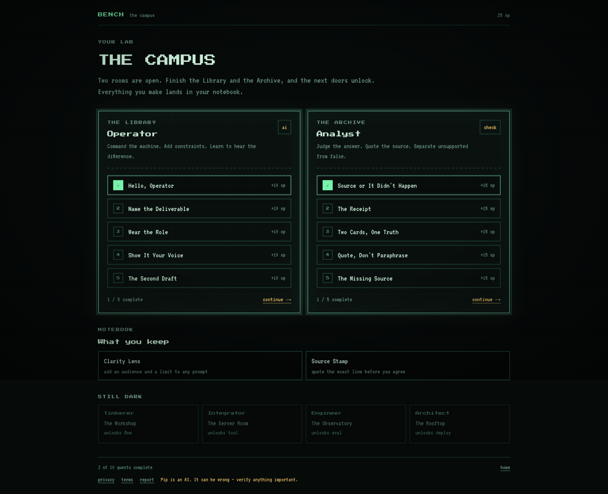

<div align="center">

# BENCH

### A pixel lab where complete beginners learn to actually use AI.

Wake a dormant agent in a basement. Teach it what you know. One quest at a time.

[](https://nextjs.org)
[](https://react.dev)
[](https://www.typescriptlang.org/)
[](https://tailwindcss.com)
[](./LICENSE)

**[Open the live lab →](https://bench-sepia.vercel.app)**

[Run it](#run-it) · [How it works](#how-it-works) · [Roadmap](#roadmap)

</div>


## What is this?

Bench is a game, not a course catalog.

You arrive in a dark basement lab and find **Pip** — a small machine that has been waiting a long time. It can talk, but it can't tell when it's wrong. Over six ranks you teach it to verify, use tools, run flows, and eventually work without you.

It's built for people who don't write code: BBA, MBA, BCom, design, and anyone who wants to use AI well without a CS degree. The terminal is a guided command box, not a shell. The first command anyone types is `ai "..."` — never `ls`.

**The design rule:** every rank unlocks a new *verb*, not just more lessons.

## What's in the beta

- **The prologue** — four beats, first win in under a minute: wake Pip, run your first command, ask something real, catch a confident lie
- **Operator rank** — five quests on instruction: constraints, deliverables, roles, voice, and revision. Ends in `ai`
- **Analyst rank** — five quests on evidence: quoting a card, scope, recency, exact wording, and unsupported claims. Ends in `check`
- **Campus map** — two active rooms, four locked, with per-rank progress and a notebook of artifacts
- **Real AI behind every command** — Agnes 3.0 Flash, streamed from a server route. Prompt scope, moderation, rate limits and a deterministic fallback
- **Local progress** — XP, completed quests and artifacts in `localStorage`; no account required

| The prologue | Quest 01 | The campus |
| --- | --- | --- |
|  |  |  |

## Run it

Requires Node.js 20.9 or newer.

```bash
npm install
cp .env.example .env.local   # add your Agnes AI key to AI_API_KEY
npm run dev
```

Open [http://localhost:3000](http://localhost:3000).

The app runs without a key using a deterministic mock. To check the provider before opening the app:

```bash
npm run ai:check
```

```bash
npm run lint       # eslint
npm run typecheck  # tsc --noEmit
npm run build      # production build
```

### Deploy

Hosted on Vercel. Set `AI_API_KEY`, `AI_BASE_URL`, and `AI_MODEL` in the project environment, then:

```bash
vercel --prod
```

No database, auth provider, or other service to provision.

## How it works

**Real model, server-side.** The `ai` command posts to `/api/ai`, which calls Agnes AI's OpenAI-compatible endpoint and streams the answer back. The key lives in `.env.local` (or Vercel environment variables) and never reaches the browser. If the provider fails, the terminal falls back to a deterministic answer so the lesson still works.

**Scoped by design.** The prologue accepts any question. Quests declare a topic whitelist, so out-of-scope prompts are redirected without a model call. On top of that: a 220-token output cap, a 20-request hourly limit per IP, and a prompt cache for repeats.

**Progress is local.** XP and notebook items live in `localStorage`, read through `useSyncExternalStore` and updated by an append-style event (`bench:progress`). There is no auth or database yet.

**The seam is deliberate.** `Terminal` only renders lines; the phase machine owns state. A real model proxy and a sandboxed runtime can slot in behind the same interface without rewriting the content. That's the next build.

**Nothing can be broken.** Hints, retries, and reset are part of the design. The prologue has no wrong answer.

## Project structure

```text
src/
  app/
    page.tsx           landing page
    play/page.tsx      the prologue
    campus/page.tsx    rank map and notebook
    quest/[id]/page.tsx  generic quest player
    privacy/page.tsx   privacy policy
    terms/page.tsx     terms of use
    api/ai/route.ts    model proxy: scope, cap, cache, stream
    globals.css        CRT, pixel panels, buttons
  components/
    Prologue.tsx       prologue state machine + copy
    QuestPlayer.tsx    generic quest renderer
    Campus.tsx         rank map and notebook
    Dialogue.tsx       typewriter + Pip's voice
    Terminal.tsx       line renderer + streaming
    PipSprite.tsx      the pixel robot
    ProgressStrip.tsx  local XP display
    LegalLinks.tsx     privacy, terms, AI disclosure
  game/
    types.ts           ranks and quest types
    quests.ts          ten quests, two ranks
  lib/
    ai.ts              Agnes provider
    ai-quests.ts       server-owned prompts, scopes, cards
    ai-client.ts       browser streaming client + parsers
    moderation.ts      safety gate
    rate-limit.ts      memory + Redis limiter
    session.ts         signed session cookie
    progress.ts        XP, completed quests, artifacts
    useProgress.ts     useSyncExternalStore hook
scripts/check-ai.mjs   provider smoke test
.env.example           environment template
docs/                  README screenshots
```

## Design rules

1. The first command is `ai "..."`, never `ls`.
2. Nothing can be broken. Nudges, never red X's.
3. The prologue is a chapter, not a gate.
4. Each rank unlocks a new verb, not just more lessons.

## Roadmap

| Rank | Zone | New verb | Promotion test |
| --- | --- | --- | --- |
| **Operator** | Library | `ai` | The Confident Liar |
| **Analyst** | Archive | `check` | The Vague Machine |
| **Tinkerer** | Workshop | `flow` | The Runaway |
| **Integrator** | Server Room | `tool` | The Overreach |
| **Engineer** | Observatory | `eval` | The Gauntlet |
| **Architect** | Rooftop | `deploy` | The Capstone |

Next up:

- The Confident Liar and The Vague Machine — the two rank bosses
- Ranks 3–6: `flow`, `tool`, `eval`, `deploy`
- A shared rate limiter (Upstash) and Sentry once the beta goes public
- Auth and synced progress once retention is proven

## Status

Public beta. The `ai` and `check` commands run through Agnes AI, with a deterministic fallback when no key is present. XP is local and there is no auth or database yet — the goal is to prove the loop before adding accounts.

Independent student project. Not affiliated with any company or institution.

## License

MIT — see [LICENSE](./LICENSE).
